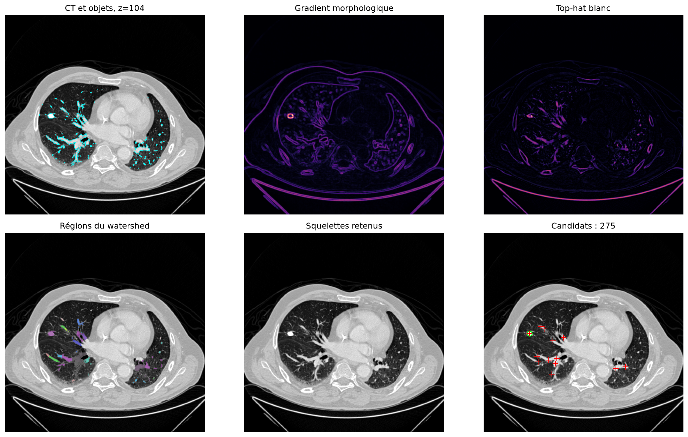
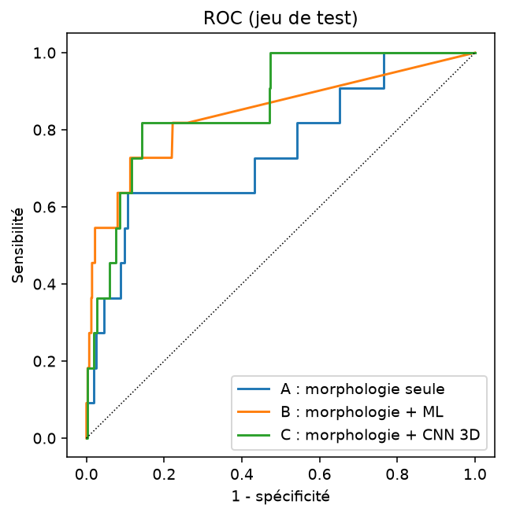
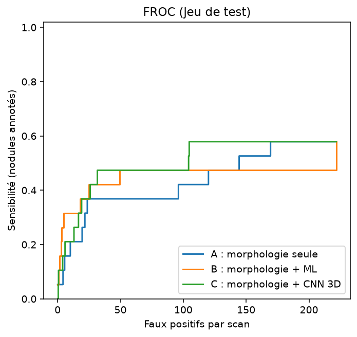
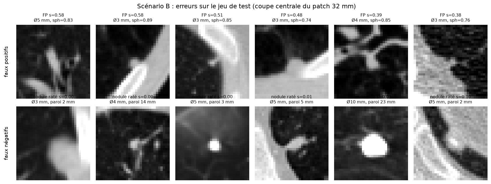

# lung-cancer-morpho

Détection de nodules pulmonaires sur scanners LUNA16 par morphologie mathématique,
puis classification des candidats par règles (A), machine learning (B) et CNN 3D (C).
Projet de morphologie mathématique, binôme de deux étudiants. Les résultats sont
expérimentaux et ne constituent pas un outil de diagnostic.

## Installation

```powershell
python -m venv .venv
.venv\Scripts\activate
pip install -r requirements.txt
pip install xgboost torch --index-url https://download.pytorch.org/whl/cpu --extra-index-url https://pypi.org/simple
```

## Données (hors Git)

Placer LUNA16 dans `data/luna16/` :

```
data/luna16/annotations.csv
data/luna16/candidates.csv
data/luna16/subset0/ , subset1/      # scanners .mhd/.raw
data/luna16/seg-lungs-LUNA16/        # masques de référence des poumons
```

Jeu de données utilisé : <https://huggingface.co/datasets/Yousra0x0/LUNA16_RAW>.
`data/` est ignoré par Git (les scans, un cache `data/cache` et les patchs 3D `data/patches` y sont écrits).
Les 25 patients de travail sont dans `results/patients.csv` (15 `dev`, 10 `test`).

## Structure

```
config.yaml        paramètres de segmentation et de détection (éléments structurants, seuils)
notebooks/         01 exploration, 02 segmentation, 03 détection, 04 classification, 05 évaluation
src/               code réutilisable (voir ci-dessous)
results/           tableaux CSV, prédictions, figures
```

| Fichier | Rôle |
|---|---|
| `src/segmentation.py` | `segment_lungs` : seuillage, ouverture, fermeture, remplissage |
| `src/eval_segmentation.py` | Dice et IoU contre les masques LUNA16 |
| `src/detection.py` | `find_candidates` : distance, marqueurs, watershed, troncature, squelette |
| `src/run_detection.py` | détection + rappel/FP par scan + figures de contrôle |
| `src/tune_detection.py`, `src/diagnose_detection.py` | réglage sur `dev` et analyse des nodules manqués |
| `src/features.py` | étiquettes, descripteurs, patchs 3D (`results/features.csv`) |
| `src/classify.py` | scénarios A, B, C (`results/predictions_*.csv`) |
| `src/metrics.py` | métriques, ROC, FROC, tableau comparatif |
| `src/ablation.py` | étude d'ablation |
| `src/error_analysis.py` | figures de faux positifs / faux négatifs |

## Commandes (dans l'ordre)

```powershell
python src/eval_segmentation.py          # phase 2 : Dice/IoU
python src/run_detection.py --split all  # phase 3 : candidats, rappel, figures
python src/features.py                   # phase 4 : descripteurs + patchs
python src/classify.py                   # phase 4 : scénarios A, B, C (le CNN est long sur CPU)
python src/metrics.py                    # phase 5 : tableau, ROC, FROC
python src/ablation.py                   # phase 5 : ablation
python src/error_analysis.py             # phase 5 : erreurs
```

`run_detection.py --limit N` écrase `results/candidates.csv` et `detection_eval.csv` : à éviter
hors test rapide. Le split `test` n'a jamais servi au réglage : les seuils de détection, les
règles du scénario A et les hyperparamètres de B et C sont choisis sur `dev` uniquement
(validation croisée groupée par patient).

## Résultats

**Segmentation (25 patients).** Dice moyen 0,974, IoU moyen 0,950 (pire cas 0,930).

**Détection.** Le baseline de départ retrouvait 12 nodules sur 25 sur `dev` (rappel 0,48,
16 FP/scan). Le diagnostic des nodules manqués (`src/diagnose_detection.py`) a montré trois
causes : filtre squelette qui rejette les nodules collés à un vaisseau (6), pas de graine
de watershed car `min_distance_mm` trop grand (5), seuil d'intensité trop haut (2). La
correction retenue tronque chaque région à une boule centrée sur le pic de distance
(`candidate_truncate_factor`) et accepte des graines plus petites (`candidate_min_seed_radius_mm: 1.2`).

| Split | Nodules retrouvés | Rappel | FP / scan |
|---|---|---|---|
| dev (réglage) | 22 / 25 | 0,88 | 215,6 |
| test | 11 / 19 | 0,58 | 221,7 |

Le rappel chute sur `test` : le réglage sur 15 scans généralise mal. Les ~220 FP par scan
sont à filtrer par la phase 4, et le rappel de détection plafonne la sensibilité de tous
les classifieurs (0,58 sur `test`).

**Classification (jeu `test` : 10 patients, 2 228 candidats, 11 positifs, 19 nodules annotés).**
Voir `results/comparaison_scenarios.csv`, `results/figures/roc.png` et `froc.png`.

| Scénario | AUC-ROC | Sensibilité à 4 FP/scan (FROC) |
|---|---|---|
| A : règles morphologiques | 0,75 | 0,05 |
| B : morphologie + ML (Random Forest choisi en validation) | 0,84 | 0,26 |
| C : morphologie + CNN 3D | 0,87 | 0,16 |

Avec 11 positifs en test, ces écarts ne sont pas statistiquement significatifs. Le seuil
0,5 donne des sensibilités peu parlantes sur une classe à 0,6 % ; la comparaison repose sur
les courbes ROC et FROC.

**Ablation** (`results/ablation_detection.csv`, `ablation_descripteurs.csv`, `ablation_chaine.csv`).
7 étapes sur 12 de la chaîne reposent sur la morphologie (58 %). Variation sur `test` en
retirant une étape : fermeture -0,21 de rappel ; watershed -0,16 de rappel mais 222 -> 18
FP/scan ; troncature en boule -0,05 de rappel pour -96 FP/scan ; ouverture de segmentation
sans effet net ; squelette sans effet dans la configuration finale (la troncature rend le
filtre inopérant). Côté descripteurs, retirer ceux de forme (sphéricité, solidité,
élongation) coûte 0,06 d'AUC ; le gradient seul n'apporte presque rien.

## Figures

Détection : CT, masque pulmonaire, gradient, top-hat, watershed, squelettes retenus et annotation
(une figure par scan dans `results/detection_figures/`).



Comparaison des scénarios A, B et C sur le jeu de test :

| ROC | FROC |
|---|---|
|  |  |

Analyse d'erreurs (scénario B) : faux positifs les mieux notés et nodules les moins bien notés.



## Limites

25 patients, 33 candidats positifs au total, un seul jeu de données, pas de validation
clinique. Les paramètres de détection sont réglés sur 15 scans ; le CNN est entraîné sur
très peu de positifs (suréchantillonnage et augmentation, perte pondérée) et ne bat pas
clairement les descripteurs morphologiques.
